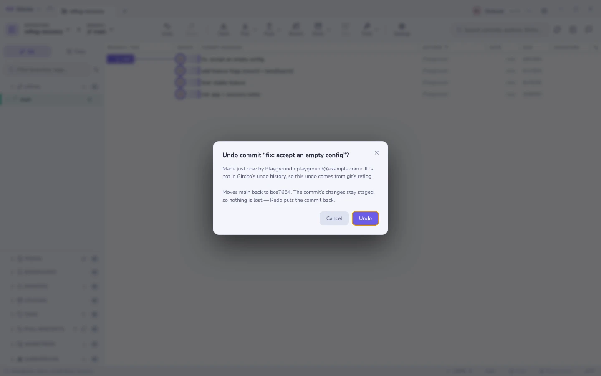

# Recovery & the reflog

Git rarely loses anything. The hard part is finding it again.

## Reflog

Every move of `HEAD` — and of each branch — with what caused it: checkout,
reset, rebase, amend, a forced fetch. From any past entry you can **check it
out**, **branch from it**, or **hard-reset to it**.


This is the "I just reset the wrong branch" button.

## WIP snapshots

Uncommitted work is the one thing the reflog cannot save, so Gitcito snapshots
it: the **whole working tree — modified, staged and untracked files** —
committed through a throwaway index and pinned under `refs/gitcito/wip`.
Neither your real index nor your stash list is touched.


Three things take one:

| Trigger | When |
|---------|------|
| **Guard** | Automatically, right before a destructive action — discard, clean, hard reset, restore from a commit. On by default; toggle it in the snapshots dialog. |
| **Timer** | Every 5 / 15 / 30 minutes while the repo is open. |
| **By hand** | The **Snapshot now** button. |

The guard is the one that matters: the moment work is usually lost forever is
the second after a discard you didn't mean. With the guard on, that state is a
snapshot — open the list, click restore, breathe again.

Select a snapshot to see the files it captured, preview any file's change, and
restore a **single file** or the whole tree. Restoring copies files out of the
snapshot over the current copies — a guard snapshot is taken first, so a
restore is itself undoable.

**Limits worth knowing.** A timer or guard tick that finds nothing new records
nothing. Restore overwrites and recreates files, but never deletes a file you
created after the snapshot. Ignored files are not captured. Snapshots are
local hidden refs: never pushed, safe from `git gc`, newest 50 kept.

## Guided bisect

Mark commits good and bad, watch the range narrow, land on the first bad commit.
Gitcito tracks how many steps are left, so you know whether you are two
questions from the answer or ten.


### Let a command decide

Once the range is seeded, **Let a command decide** hands the whole search to
`git bisect run`. Git checks out each candidate, runs your command, and reads
its exit code:

| Exit code | Means |
|-----------|-------|
| `0` | Good — the bug is not here |
| `125` | Cannot test this one; skip it |
| anything else | Bad |

A test suite already speaks that language, which is why `npm test` is usually
the whole answer. Gitcito offers this project's own scripts as one-click fills,
streams the output while it runs, and lands on the first bad commit without you
answering a single question.


**What to watch for.** The command runs on *every* commit git tests, so a
command that deploys, publishes, or writes outside the repository will do that
several times over. Keep it to something that only reads and reports. **Stop**
kills the run and leaves the session open, so you can carry on marking by hand;
**Abort** ends the bisect entirely.

A command that fails for an unrelated reason — a missing dependency at that
point in history, say — marks a good commit bad and sends the search to the
wrong place. Exiting `125` from a wrapper script is git's way out of that.

## A leftover lock file

Git takes a `.lock` file next to whatever it is about to write, and removes it
when the write lands. A process that dies holding one — a crashed editor, a
terminal closed during `git commit`, a fetch killed while pruning remote refs —
leaves the lock behind, and from then on every write fails with the same line:

```
error: could not delete references: cannot lock ref 'refs/remotes/origin/x':
Unable to create '…/refs/remotes/origin/x.lock': File exists.
```

The repository is not damaged. A file is simply in the way.

Gitcito retries a handful of times first, because a lock held by a *running*
git usually clears within milliseconds. When it does not, the failure opens a
dialog instead of a wall of text: every lock still on disk, how old each one is,
and one button that removes them and re-runs the action that failed.

**Age is the whole argument.** A lock younger than 30 seconds is presumed to
belong to a git that is still working, and Gitcito refuses to delete it — it
offers to wait and retry instead. Older ones are offered for removal, oldest
first, and the dialog says plainly what to check before agreeing: that no
editor, terminal or other Git client is working in this repository right now.
Deleting a lock out from under a live write is how an index gets torn.

The scan covers the repository's own git directory and its common directory, so
a linked worktree's locks are found too. Submodules are skipped — those belong
to another repository, and are cleared by opening it.

## Undo / redo

Most operations push an entry onto an undo stack, so <kbd>⌘Z</kbd> reverses the
last one where git allows it. Hover **Undo** or **Redo** in the toolbar to see
what it would do before you click: the tooltip names the next step.

### Changes made outside Gitcito

A commit from the terminal, a reset from your editor, a checkout by a coding
agent. None of them are in Gitcito's undo stack, but git wrote every one into
the reflog along with where the branch was before. So **Undo** reaches those
too: whichever change happened last, inside the app or outside it, is the one
that gets undone.

Because the change came from somewhere you may not have been watching, it is
never undone silently. A preview names it, says when it happened and who git
recorded, and says what the undo will do. If the commit has already been pushed,
the preview says so too. A toast confirms the result, or reports git's refusal.



| Last change | What Undo does | What Redo does |
|-------------|----------------|----------------|
| Commit | `reset --soft` to the parent. The commit is gone and its changes stay staged | Restores the commit |
| Amend | `reset --soft` to the commit before the amend. What the amend added stays staged | Restores the amended commit |
| Reset | Moves the branch back to where it was. `--keep` on a clean tree, `--mixed` on a dirty one, so local changes survive either way | Moves it forward again |
| Merge, pull, rebase, cherry-pick, revert | `reset --keep` to where the branch was before. Git refuses if your local changes would be overwritten | Moves it forward again |
| Checkout / switch | Checks the previous branch out again | Checks the later one out |

Press Undo again to keep walking back through earlier changes made outside
the app.

**What it cannot do.** The reflog only records *ref moves*. Staging, stashing,
editing files, creating or deleting branches and tags all leave HEAD where it
was, so Undo cannot reverse them when they happen outside Gitcito.
Uncommitted work that an outside `reset --hard` threw away was never in the
reflog, and nothing can bring it back. Your first commit on a new branch has no
earlier position, so it cannot be uncommitted this way. Git records the same
name for everything on one machine, so "by" tells you the identity, not which
tool. And the walk stops at the first change Gitcito made itself, because
reaching past it would undo things out of order. After a restart the app no
longer knows which changes it made, so its own earlier commits become
undoable this way too.

Before acting, Undo checks that HEAD is still where the preview said it was.
If something moved it in the meantime, nothing happens and a toast tells you
why.

**See also:** [What changed since](range-diff.md) · [Stashes](stashes.md)
