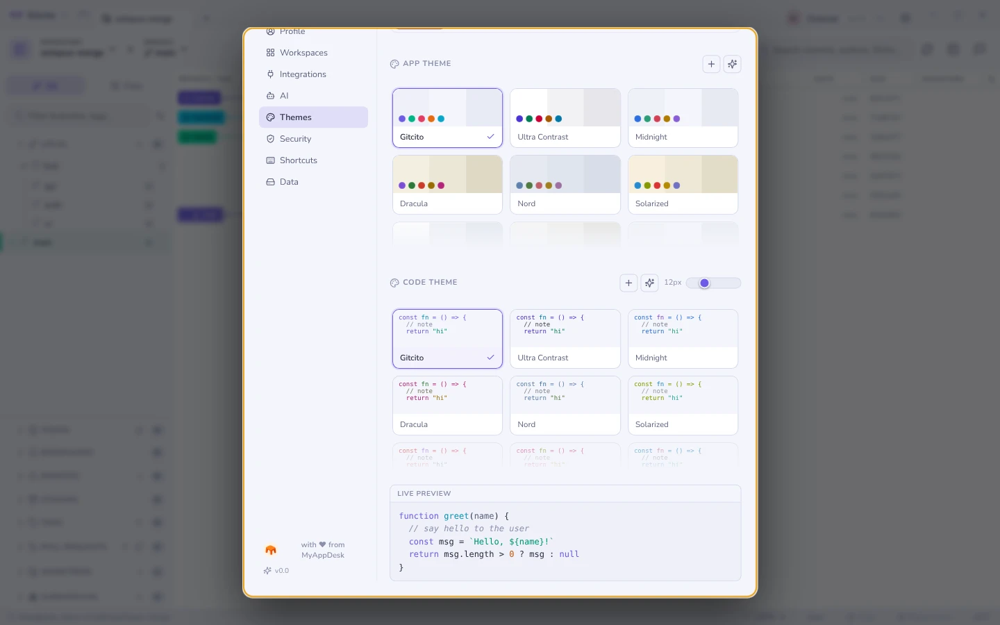

# Themes & appearance

Built-in themes — Gitcito, Nord, Dracula, Solarized, GitHub, Monokai,
Midnight, Contrast and Daltonic — each with a light and a dark variant.

- **Light, dark, or follow the OS**, switched live.
- **Custom themes**, and **AI-generated** ones from a prompt.
- Adjustable **code font size**.
- A separate **graph style**: lane palette, corner style, row density and line
  thickness, with a live mini-graph preview.

In **Settings → Themes** the App Theme and Code Theme lists, and the graph
palettes, each scroll inside their own box: two rows at a time, with the
cut-off row fading out until you reach the end. Each list opens on your current
choice, so a growing collection of custom themes does not push the rest of the
page out of reach. A list short enough to fit shows in full, with no fade.

## Layout

Sidebar on the left or the right, resizable panels everywhere, a collapsible
sidebar for when the graph deserves the whole window, and per-repository
terminal placement.

**See also:** [The commit graph](graph.md) · [Profiles](profiles.md)
